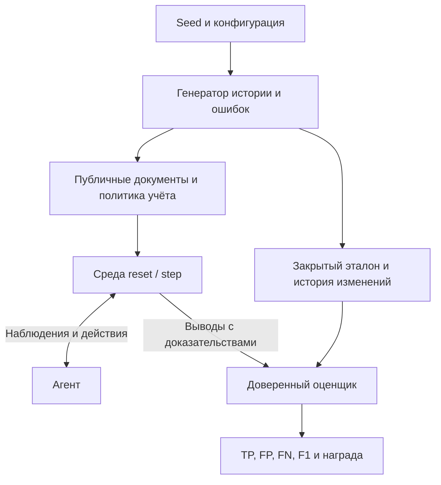

# Genesis FinTech

**Воспроизводимая среда для проверки ИИ-агентов в финансовом аудите.** Агент исследует счета, платежи, проводки и курсы вымышленной компании, затем отправляет найденные расхождения со ссылками на доказательства. Оценщик считает, сколько ошибок найдено, пропущено или отмечено ошибочно.

Интерфейс `reset` / `step` и записанные траектории позволяют воспроизводить прогоны и проводить эксперименты с обучением с подкреплением.

[](https://github.com/24kBlood/GenesisHackathon/actions/workflows/data-contract.yml)
[](https://github.com/24kBlood/GenesisHackathon/actions/workflows/offline-verify.yml)

[Быстрый старт](#быстрый-старт) · [Данные](#данные-и-траектории) · [Как устроена среда](#как-устроена-среда) · [Проверки](#проверки-и-результаты)

## Быстрый старт

Для демо нужен Python 3.11. Скриптовая политика покажет каждый шаг от первого чтения записей до итоговой оценки.

Если у вас ещё нет копии репозитория:

```sh
git clone https://github.com/24kBlood/GenesisHackathon.git
cd GenesisHackathon
```

**Windows PowerShell**

```powershell
py -3.11 -m venv .venv
.\.venv\Scripts\python.exe -m pip install --no-deps -r tests/requirements-schema.lock
$env:PYTHONPATH = 'src'
.\.venv\Scripts\python.exe -m genesis.cli demo
```

Если команда `py` недоступна, используйте `python -m venv .venv` с установленным Python 3.11.

<details>
<summary>Linux и macOS</summary>

```sh
python3.11 -m venv .venv
. .venv/bin/activate
python -m pip install --no-deps -r tests/requirements-schema.lock
PYTHONPATH=src python -m genesis.cli demo
```

</details>

В демо с seed по умолчанию `20260304` политика находит одну ошибку конвертации за пять шагов. В итоговой строке будут `TP=1 FP=0 FN=0`, `F1=1.0000` и `Return=0.9920`.

### Проверить агента на выбранном эпизоде

`run-policy` принимает публичный `episode_id` из train/dev или имя диагностического профиля, например `standard-03`. Ниже прогон на одном из масштабированных dev-эпизодов.

```sh
PYTHONPATH=src python -m genesis.cli run-policy episode-1c5f979080b0fb56fda354e3 --policy simple_reconciliation
```

В PowerShell используйте `.\.venv\Scripts\python.exe` с `$env:PYTHONPATH = 'src'` перед `-m genesis.cli`. Для своего агента передайте `--image <локальный-образ>` вместо `--policy`. Воркер подключается по JSONL и запускается в изолированном контейнере Docker. Параметр `--trace` сохраняет публичный журнал в новый файл. [Протокол и сборка образа политики](docs/BASELINE_POLICIES.md#запуск-и-контейнер-политики)

После установки `python -m pip install ".[verify]"` доступны команды `genesis demo`, `genesis run-policy` и `genesis verify --all` из любой папки.

## Как устроена среда



Один эпизод охватывает одну компанию и один отчётный период. Генератор строит согласованную историю, вносит ошибки и сохраняет причины изменений. Агент читает записи через `list_records`, `get_record` и `get_document`, считает через `calculator` и отправляет выводы через `submit`. Предел составляет 50 записей на страницу и 100 действий на эпизод, включая отправку. [Контракт данных и действий](docs/DATA_CONTRACT.md)

Оценщик сопоставляет выводы с эталоном один к одному по типу, затронутым записям, сумме, валюте и достаточности доказательств. Терминальная награда рассчитывается по формуле `clip(2 × F1 − 1 − 0.002 × шаги_исследования, −1, 1)`. В режиме `train` агент получает её после отправки вывода. В `eval` итоговая награда и диагностика остаются у оценщика. [Сопоставление и награда](docs/REWARD_AND_MATCHING.md) · [Граница изоляции](docs/ISOLATION_AND_LEAKAGE.md)

## Данные и траектории

| Выборка v1.1.0 | Эпизоды | Проводки на эпизод | Документы на эпизод |
| --- | ---: | ---: | ---: |
| [train](data/train/) | 10 | 16–239 | 7–115 |
| [dev](data/dev/) | 10 | 16–226 | 7–111 |

Данные охватывают пять валют, четыре часовых пояса, чистые случаи и четыре типа ошибок: дубли счетов, неверное распределение платежей, ошибочную конвертацию валюты и нарушения границ отчётного периода. Четыре эпизода из двадцати попадают в рекомендованный ТЗ диапазон размеров. [Состав и воспроизведение данных](data/README.md) · [ID эпизодов и SHA-256](data/checksums.json)

В `trajectories.jsonl` записан реальный открытый прогон на масштабированном эпизоде train. За **11 шагов** политика сделала **8 верных выводов** с итоговой наградой **0,980**. Журнал содержит действия, публичные наблюдения и признаки завершения. [Траектория](trajectories/trajectories.jsonl) · [Как воспроизвести запись](docs/TRAJECTORIES.md)

## Проверки и результаты

Запустите `python -m genesis.cli verify --all` в окружении быстрого старта. Команда проверяет схемы, датасет, контракт среды, награду и траектории. Для PowerShell используйте интерпретатор из `.venv`. [Матрица проверок](docs/QA_CHECKLIST.md)

### Офлайн-проверка в Docker

Образ собирается с зафиксированными зависимостями. После сборки проверка работает без сети в пределах 2 CPU и 4 ГиБ памяти. Команды для Bash:

```sh
docker build --tag genesis-verify:local .
docker run --rm --pull never --network none --cpus 2 --memory 4g --memory-swap 4g \
  --read-only --tmpfs /tmp:rw,nosuid,nodev,noexec,size=64m,mode=1777 \
  --cap-drop ALL --security-opt no-new-privileges --pids-limit 64 \
  genesis-verify:local python -m genesis.cli verify --all
```

Изоляция внешнего воркера проверяется отдельным заданием CI с реальным Linux-контейнером. [Результаты офлайн-прогона](https://github.com/24kBlood/GenesisHackathon/actions/runs/44988409768) · [Проверка изоляции](https://github.com/24kBlood/GenesisHackathon/actions/runs/44988409731) · [Перенос и сборка без сети](docs/OFFLINE_RUN.md)

### Что показала локальная диагностика

На 20 открытых диагностических профилях сравнили четыре политики. Проверка воспроизводимости прошла **20 из 20** повторов и **20 из 20** пар с перестановкой записей и заменой ID. Итоговый балл жюри определяется отдельно на скрытых эпизодах. [Методика и полный отчёт](docs/DESIGN_NOTE.md#локальные-измерения)

| Политика | Средний F1 | Средняя награда |
| --- | ---: | ---: |
| Случайный исследователь | 0,250 | −0,504 |
| Простая сверка | 1,000 | 0,992 |
| «Пометить всё» | 0,000 | −1,000 |
| Oracle · эталон оценщика | 1,000 | 1,000 |

## Карта репозитория

| Путь | Назначение |
| --- | --- |
| `src/genesis/generation` | [Генератор](src/genesis/generation/) истории компании, открытых документов и причинных изменений |
| `src/genesis/environment` | [Среда](src/genesis/environment/) с `reset`, `step`, инструментами и транспортом политики |
| `src/genesis/evaluation` | [Оценщик](src/genesis/evaluation/) с сопоставлением, метриками и доверенным Oracle |
| `src/genesis/policies` · `src/genesis/cli` | [Базовые политики](src/genesis/policies/) и [команды запуска](src/genesis/cli/) |
| `schemas` · `tests` | [JSON Schema](schemas/) и [проверки](tests/) |
| `docs` · `materials/submission` | [Архитектура](docs/ARCHITECTURE.md), [ограничения](docs/LIMITATIONS.md) и [аудит материалов для жюри](materials/submission/README.md) |

Код распространяется по лицензии MIT. Правила работы команды и сведения о сторонних компонентах находятся в репозитории. [LICENSE](LICENSE) · [NOTICE](NOTICE) · [CONTRIBUTING](CONTRIBUTING.md)
