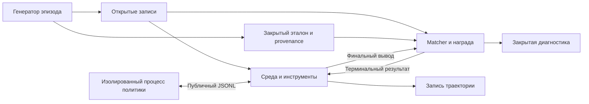

# Архитектура Genesis FinTech

**Статус** — проект решения для ARCH-01. Компоненты, команды и проверки ниже запланированы. Результаты прогона будут опубликованы после реализации на проверенном коммите.

## Назначение

Среда позволяет политике расследовать финансовые расхождения в синтетической компании и отправлять структурированные выводы с доказательствами. Оценщик выдаёт воспроизводимое решение о совпадении с эталоном. Такой интерфейс пригоден для последующего обучения на траекториях. Результаты характеризуют симулятор и тестовые политики в рамках кейса.

Реализация начинается от чистой базы на Python 3.11. Целевой пакет — `src/genesis/`. Для ядра предлагаем стандартную библиотеку, целые денежные значения и `Decimal` для FX. Дополнительные инструменты проверки фиксируются в зависимостях, если понадобятся.

## Компоненты

| Компонент | Ответственность | Зависимости |
| --- | --- | --- |
| `domain` и `schemas/` | Форматы эпизода, денег, ID, действий и выводов. Публичные и закрытые модели разделены. | — |
| `generation` | Согласованная история, открытые документы, причинные изменения, эталон и provenance. | `domain` |
| `evaluation` | Валидация вывода, взаимно однозначное сопоставление, метрики и награда. | `domain` |
| `environment` | Состояние эпизода, пять действий, проекция наблюдений, лимиты и переходы. | Публичные модели `domain`, интерфейс оценки |
| `policies` | Три обычных адаптера на публичном протоколе. Oracle запускается в контуре оценщика. | Публичный протокол, закрытый интерфейс для Oracle |
| `trajectories` | JSONL, повтор действий и проверка состава наблюдений. | Публичные модели и интерфейс среды |
| `cli` и контейнеры | Доверенная оркестрация генерации, оценки, запуска изолированных политик и локальной проверки. | Все компоненты |

Планируемая политика сверки и случайный исследователь проходят через тот же интерфейс, что и адаптер «пометить всё». Политики получают открытые данные по запросу. Доверенный процесс передаёт эталон оценщику и Oracle. В закрытом режиме терминальный результат остаётся в закрытой диагностике.

## Порядок реализации

1. Зафиксировать контракт и JSON Schema. Собрать первый сквозной эпизод с дублем счёта и ошибкой распределения. Прогнать `reset`, чтение, `submit` и эталонную награду.
2. Добавить FX и период, чистые эпизоды, возвраты, разбитые платежи и законные повторы.
3. Добавить два взаимодействующих сценария и выпустить воспроизводимые наборы из 10 train и 10 dev эпизодов с такими сценариями. Добавить изолированный запуск политик, траектории и проверки ложных выводов и недоступных данных. Прогнать все четыре политики на общем наборе.
4. Подготовить офлайн-контейнер, команду проверки и демонстрацию с измеренными результатами. Целевая команда после сборки пакета — `python -m genesis.cli verify --all`. Предусмотрен также `make verify`.

Недоступность закрытых данных обеспечивается границей процессов уже в проекте интерфейса. Отдельные ограниченные контейнеры и их интеграционные проверки нужны к этапу сдачи.

## Приёмка по ТЗ

| Критерий | Что проверяем |
| --- | --- |
| Контракт и изоляция, 25 | 20 проверок схем, `reset`, `step`, лимитов, завершающих состояний, обработки ввода и отсутствия закрытых данных в протоколе политики. |
| Данные и эталон, 25 | По ТЗ жюри независимо проверяет доступность и достаточность открытых доказательств для всех типов ошибок. Локальная приёмка проверяет инварианты, причинное расхождение и доказательства на наборе из 20 эпизодов. [RFC #28](https://github.com/24kBlood/GenesisHackathon/issues/28) предлагает команде отдельный инструмент пересчёта с первым примером на FX. |
| Надёжность награды, 25 | 20 проверок совпадений, ошибок доказательств, денежных значений и валют, чистых случаев, дублей и стоимости шагов. |
| Воспроизводимость и обобщение, 15 | 20 пар. Повтор с тем же входом сохраняет данные и переходы, перестановка записей и биекция ID сохраняют результат Oracle с учётом отображения. |
| Инженерия и объяснение, 10 | Офлайн-запуск одной командой, версии конфигураций, пригодный JSONL, измеренный разбор сбоев и известные ограничения. |

Все четыре политики официально запускаются на одном закрытом наборе из 20 эпизодов, включая пять чистых и пять с взаимодействующими ошибками. Ещё 20 парных проверок меняют порядок записей и идентификаторы. Локальные проверочные конфигурации дополняют официальный закрытый набор. Диагностика политик включает P, R, F1, возврат, шаги и время. Время измеряется отдельно от воспроизводимого журнала.

## Проектные решения

- [ADR 0000. Контекст и границы среды](ADR/0000-context.md)
- [ADR 0001. Эпизод и модель данных](ADR/0001-episode-and-schema.md)
- [ADR 0002. Изоляция оценщика и протокол эпизода](ADR/0002-evaluator-isolation.md)
- [ADR 0003. Сопоставление и награда](ADR/0003-matching-and-reward.md)
- [Правила работы команды](../CONTRIBUTING.md)
